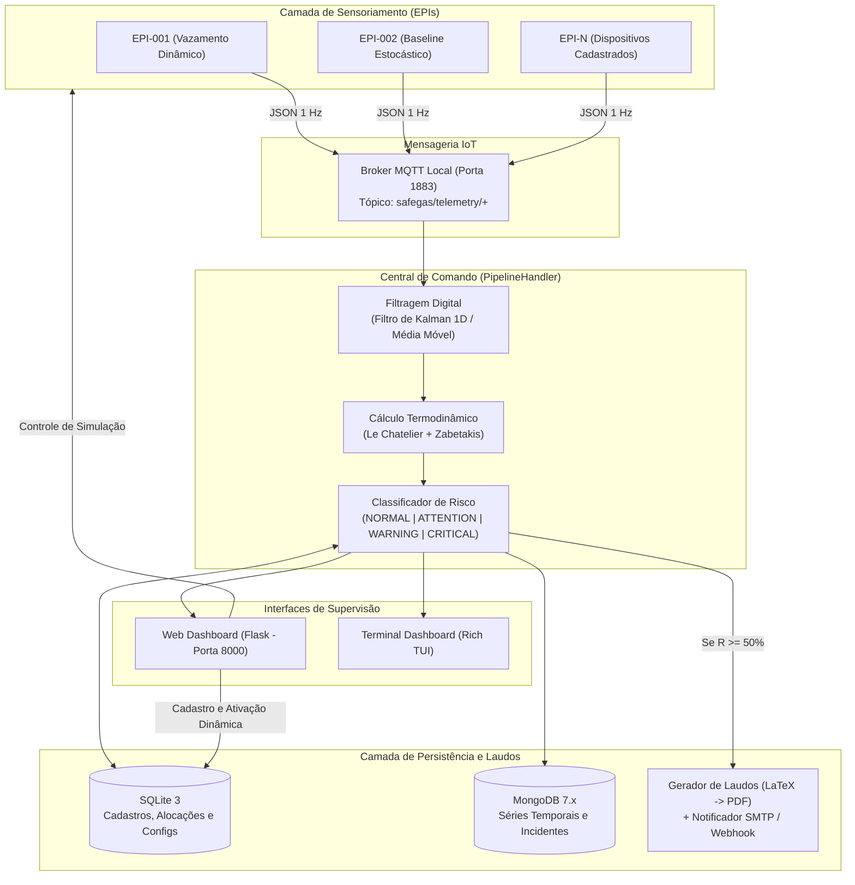

# SafeGas Monitor

**Disciplina:** Projetos em Engenharia de Software / Engenharia da Computação — UNIVAP (2026)  
**Resumo:** Plataforma de monitoramento em tempo real para detecção de atmosferas potencialmente explosivas (LEL/LIE) em ambientes industriais e espaços confinados, integrando telemetria IoT via MQTT, filtragem digital de sinais, persistência híbrida (SQLite e MongoDB) e emissão automatizada de laudos técnicos em PDF via LaTeX.

---

## Sumário

1. [Visão Geral](#visão-geral)
2. [Arquitetura e Fluxo de Dados](#arquitetura-e-fluxo-de-dados)
3. [Tecnologias Utilizadas](#tecnologias-utilizadas)
4. [Gases Monitorados e Limiares de Risco](#gases-monitorados-e-limiares-de-risco)
5. [Fundamentação Matemática e Simulação Física](#fundamentação-matemática-e-simulação-física)
6. [Interfaces de Operação](#interfaces-de-operação)
7. [Instalação e Execução](#instalação-e-execução)
8. [Suíte de Testes](#suíte-de-testes)
9. [Estrutura de Diretórios](#estrutura-de-diretórios)

---

## Visão Geral

O **SafeGas Monitor** foi projetado para supervisionar múltiplos detectores multigás portáteis acoplados ao Equipamento de Proteção Individual (EPI) de trabalhadores em campo. O software cobre toda a infraestrutura de processamento da Central de Comando que dará suporte ao protótipo físico embarcado.

A solução processa leituras contínuas de concentração gasosa e temperatura ambiente a 1 Hz por dispositivo. Para evitar alarmes falsos causados pela instabilidade eletroquímica natural dos sensores, o sistema aplica um **Filtro de Kalman escalar (1D)** antes de calcular o Limite Inferior de Explosividade da mistura ($LEL_{\text{mix}}$) pela **Lei de Le Chatelier**, ajustado termodinamicamente pela equação de **Zabetakis**.

Quando o índice de risco atinge ou ultrapassa 50% do $LEL_{\text{mix}}$ (nível crítico), a Central aciona automaticamente o protocolo de emergência: compila um laudo pericial em PDF contendo o histórico e as curvas de dispersão geradas via Matplotlib/LaTeX e envia o documento por e-mail via SMTP ao responsável de segurança.

---

## Arquitetura e Fluxo de Dados

O sistema adota uma arquitetura desacoplada baseada no padrão *Publish/Subscribe* sobre o protocolo MQTT:



### Etapas do Pipeline Central

1. **Ingestão MQTT (`central_command/server.py`)**: O servidor assina o tópico curinga `safegas/telemetry/#`, desserializa os pacotes JSON em objetos `TelemetryPacket` e mantém o controle de sessão por equipamento.
2. **Filtragem Digital (`central_command/filters/`)**: Mantém instâncias independentes de `KalmanFilter1D` e `MovingAverageFilter` para cada par `(device_id, gas_id)`, atenuando o ruído branco de medição sem introduzir atraso de fase severo.
3. **Cálculo de Explosividade (`central_command/lel/`)**: Aplica a correção térmica sobre o LEL individual de cada gás presente e determina o $LEL_{\text{mix}}$ da mistura e a taxa percentual de risco $R$.
4. **Enriquecimento Relacional (`database/sql/`)**: Associa em tempo real o ID do equipamento ao nome do colaborador, função, local de operação e status de calibração cadastrados no SQLite (com cache em memória para baixa latência).
5. **Persistência e Auditoria (`database/nosql/` e `reports/`)**: Armazena as leituras processadas no MongoDB e, em ocorrências críticas, aciona a geração assíncrona do laudo técnico e o envio de e-mail com controle de *cooldown*.

---

## Tecnologias Utilizadas

| Camada | Tecnologia / Biblioteca | Descrição |
|---|---|---|
| Linguagem | Python 3.11+ | Núcleo da aplicação, tipagem com `dataclasses` e concorrência via `threading` |
| Mensageria | `paho-mqtt` / `amqtt` | Cliente e broker MQTT embarcado na porta `1883` |
| Processamento Numérico | `numpy` | Geração estocástica, cálculo vetorial e filtragem digital |
| Banco de Dados Relacional | `sqlite3` (stdlib) | Persistência de EPIs, funcionários, locais de risco, alocações e parâmetros |
| Banco de Dados NoSQL | `pymongo` (MongoDB) | Persistência de alta frequência para telemetria e registro de incidentes |
| Interface Web e API | `flask` + HTML/CSS/JS | Dashboard web na porta `8000` e endpoints REST de gerenciamento |
| Interface de Terminal | `rich` | Monitoramento em modo texto (TUI) atualizado a 4 FPS no console |
| Relatórios e Gráficos | `matplotlib` + `pdflatex` | Plotagem do histórico de concentração e compilação automática de laudos PDF |
| Notificações Externas | `smtplib` + `requests` | Disparo de e-mails com laudo PDF anexado e integração via Webhook HTTP |

---

## Gases Monitorados e Limiares de Risco

Os parâmetros de inflamabilidade seguem as referências normativas **ABNT NBR IEC 60079-29-1**, **NR-33** e **NFPA 325**:

| Identificador | Gás | LEL (% v/v) | UEL (% v/v) | Característica Principal |
|---|---|---|---|---|
| `CH4` | Metano | 5,0% | 15,0% | Principal componente do gás natural; inflamável e asfixiante em altas concentrações |
| `CO` | Monóxido de Carbono | 12,5% | 74,0% | Gás tóxico inodoro resultante de combustão incompleta; inflamável em concentrações elevadas |
| `H2S` | Gás Sulfídrico | 4,0% | 44,0% | Altamente tóxico e inflamável, comum em galerias subterrâneas e processos químicos |
| `C3H8` | Propano (GLP) | 2,1% | 9,5% | Hidrocarboneto mais denso que o ar, tende a acumular-se em cotas baixas |
| `C4H10` | Butano (GLP) | 1,8% | 8,4% | Baixo limite inferior de explosividade; alto risco de ignição |

### Classificação de Alertas

A razão de risco $R = (C_{\text{mix}} / LEL_{\text{mix}}) \times 100\%$ define o estado operacional do equipamento:

| Nível | Intervalo de Risco ($R$) | Comportamento do Sistema |
|---|---|---|
| `NORMAL` | $R < 10\%$ | Operação segura; registro contínuo de telemetria |
| `ATTENTION` | $10\% \le R < 25\%$ | Registro no histórico de eventos da Central e destaque visual amarelo |
| `WARNING` | $25\% \le R < 50\%$ | Alerta preventivo laranja indicando aproximação da zona de perigo |
| `CRITICAL` | $R \ge 50\%$ | Alarme crítico vermelho, compilação do laudo LaTeX/PDF e envio imediato por e-mail |

---

## Fundamentação Matemática e Simulação Física

### 1. Lei de Le Chatelier para Misturas Inflamáveis

Para uma atmosfera contendo múltiplos gases combustíveis simultâneos com concentrações individuais filtradas $C_i$ (% v/v), o Limite Inferior de Explosividade da mistura é dado por:

$$LEL_{\text{mix}} = \frac{100}{\sum_{i=1}^{n} \frac{C_i}{LEL_{i,T}}}$$

Onde $C_{\text{mix}} = \sum_{i=1}^{n} C_i$ e a razão de risco efetiva equivale a:

$$R = \left( \frac{C_{\text{mix}}}{LEL_{\text{mix}}} \right) \times 100\% = \left( \sum_{i=1}^{n} \frac{C_i}{LEL_{i,T}} \right) \times 100\%$$

### 2. Correção Termodinâmica de Zabetakis

O aumento da temperatura ambiente reduz a energia térmica necessária para a propagação de chama, diminuindo o LEL efetivo de cada gás em relação à referência de $25^\circ\text{C}$:

$$LEL_{i,T} = LEL_{i,25^\circ\text{C}} \times \left[ 1 - 0{,}08 \times \left( \frac{T - 25}{100} \right) \right]$$

### 3. Modelagem Estocástica dos Sensores (`epi_simulator`)

Para reproduzir o comportamento físico de sensores eletroquímicos e catalíticos reais em diferentes regimes industriais, o simulador implementa quatro perfis dinâmicos combinados com inércia de difusão:

* **`DYNAMIC_LEAK` (Vazamento Não-Linear com Turbulência)**: Modela a transição de um vazamento pressurizado por meio de uma curva sigmoidal (Hermite cúbica), somada a vórtices turbulentos autorregressivos (*convective eddies*), baforadas estocásticas (*puffs*) e arraste proporcional de hidrocarbonetos secundários (`C3H8` e `C4H10`).
* **`STOCHASTIC_DRIFT` (Processo de Ornstein-Uhlenbeck)**: Modela a operação normal de campo com reversão contínua à média ($\theta$) e volatilidade ambiental ($\sigma$), evitando leituras estáticas ou artificiais:
  $$dX_t = \theta (\mu - X_t)\,dt + \sigma\,dW_t$$
* **`CYCLIC_VENTING` (Ciclo Operacional com Exaustão)**: Simula ambientes com liberação periódica de gases seguida de varredura exponencial ($e^{-k \cdot t}$) acionada por sistemas de ventilação forçada (HVAC).
* **`INTERMITTENT_BURSTS` (Micro-Vazamentos Transitórios)**: Emula fugas rápidas decorrentes de abertura de válvulas ou purgadores.
* **Inércia de Membrana ($\tau_{90}$) e Inércia Térmica**: Todas as leituras passam por um filtro físico de primeira ordem que representa o tempo de difusão molecular na cápsula porosa do sensor.

---

## Interfaces de Operação

### 1. Web Dashboard (`http://localhost:8000`)

Servido pelo Flask em `api/server.py`, o painel web oferece:
* **Aba Em Monitoramento**: Cartões de indicadores globais (tempo de atividade, dispositivos ativos, taxa de pacotes por segundo e total de laudos emitidos), tabela ao vivo de EPIs com atualização a cada 500 ms, histórico de eventos e lista de incidentes críticos.
* **Aba Cadastrados no SQLite**: Visualização de todos os detectores registrados no banco relacional, status de calibração, colaborador vinculado, local de risco e controle individual para iniciar a simulação de qualquer equipamento (`Iniciar`).
* **Cadastro Interativo de Equipamentos**: Modal para inclusão de novos EPIs com atribuição imediata a funcionários e áreas de risco. Após o registro, um modal de confirmação permite adicionar o equipamento diretamente à tela principal e iniciar sua transmissão MQTT em tempo real.
* **Configuração de E-mail de Alerta**: Modal para atualização dinâmica do endereço de e-mail destinatário dos laudos periciais em PDF (valor persistido na tabela `system_settings` do SQLite).

### 2. Terminal Dashboard (`ui/tui/`)

Construído com a biblioteca `rich`, exibe diretamente no console da Central o estado sincronizado das conexões, a tabela de risco por colaborador e os alertas recentes, ideal para acompanhamento local no servidor.

---

## Instalação e Execução

### Pré-requisitos

* **Python 3.11** ou superior.
* **Distribuição LaTeX (MiKTeX ou TeX Live)** *(opcional)*: Utilizada pelo comando `pdflatex` para compilar os arquivos `.tex` em `.pdf`. Caso não esteja instalada, o sistema salva o código-fonte `.tex` completo sem interromper a execução.
* **MongoDB 7.x** *(opcional)*: Caso o serviço local do MongoDB na porta `27017` não esteja ativo, o repositório NoSQL entra automaticamente em **modo degradado**, mantendo todas as funcionalidades em memória e no SQLite.

### 1. Instalar Dependências

```bash
pip install -r requirements.txt
```

### 2. Configurar Credenciais de E-mail (Opcional)

Para habilitar o envio real de e-mails via SMTP (Gmail) nos alertas críticos:

1. Copie o arquivo de modelo:
   ```bash
   cp config/secrets.py.example config/secrets.py
   ```
2. Edite `config/secrets.py` com seu endereço Gmail e uma Senha de Aplicativo de 16 caracteres gerada na sua Conta Google:
   ```python
   SMTP_USER = "seu_email@gmail.com"
   SMTP_PASS = "sua_senha_de_aplicativo"
   ```
*(O arquivo `config/secrets.py` está listado no `.gitignore` para evitar exposição de credenciais).*

### 3. Iniciar o Sistema Completo

#### No Windows (Atalho Automatizado)
Execute o script de lote na raiz do projeto:
```cmd
start_safegas.bat
```

#### Via Terminal (Multiplataforma)
```bash
python run_central.py
```

O comando `run_central.py` inicializa de forma coordenada:
1. O broker MQTT local em segundo plano (`mqtt_broker.py` na porta `1883`);
2. O gerenciador multi-dispositivo `SimulationManager`, carregando os EPIs ativos do SQLite (`EPI-001` em cenário de vazamento progressivo e `EPI-002` em operação estável);
3. O subscriber MQTT da Central de Comando (`CentralCommandServer`) e o `PipelineHandler`;
4. O servidor web Flask em `http://127.0.0.1:8000`;
5. A interface Rich TUI no terminal.

Para encerrar todos os serviços e liberar as portas de rede de forma limpa, pressione `Ctrl+C` no terminal.

---

## Suíte de Testes

Os testes automatizados validam cada módulo do sistema de forma independente e integrada:

```bash
# 1. Contratos de dados, serialização JSON e estrutura do projeto
python tests/test_etapa1.py

# 2. Simulador de sensores, limites físicos e perfis de sinal
python tests/test_etapa2.py

# 3. Mensageria MQTT, roteamento de sessões e SimulationManager
python tests/test_etapa3.py

# 4. Filtros digitais (Média Móvel e Filtro de Kalman 1D)
python tests/test_etapa4.py

# 5. Cálculo de LEL (Le Chatelier + Zabetakis) e motor de alertas
python tests/test_etapa5.py

# 6. Persistência relacional (SQLite) e NoSQL (MongoDB com fallback)
python tests/test_etapa6.py

# 7. Geração de gráficos Matplotlib e compilação de laudos LaTeX
python tests/test_etapa7.py

# 8. Gerenciamento de estado thread-safe e renderização da TUI
python tests/test_etapa8.py

# 9. Endpoints da API REST Flask e controle dinâmico de simulação
python tests/test_etapa9.py
```

---

## Estrutura de Diretórios

```text
SafeGasMonitor/
├── api/
│   ├── server.py                  # Servidor Flask e rotas da API REST
│   └── static/                    # Interface web (index.html, style.css, app.js)
├── central_command/
│   ├── alerts/alert_manager.py    # Classificação de risco e callbacks de alerta
│   ├── filters/
│   │   ├── digital_filters.py     # Implementação de MovingAverageFilter e KalmanFilter1D
│   │   └── pipeline.py            # Gerenciamento de filtros por dispositivo e gás
│   ├── lel/lel_calculator.py      # Equação de Le Chatelier e correção de Zabetakis
│   ├── notifier.py                # Envio assíncrono de e-mails SMTP e Webhooks
│   ├── pipeline_handler.py        # Orquestrador central do fluxo de telemetria
│   └── server.py                  # Cliente MQTT subscriber da Central
├── config/
│   ├── data_contracts.py          # Dataclasses (GasReading, TelemetryPacket, ProcessedReading)
│   ├── secrets.py.example         # Template de configuração SMTP
│   └── settings.py                # Constantes físicas, limiares e configurações de rede
├── database/
│   ├── nosql/mongo_repository.py  # Repositório MongoDB com suporte a modo degradado
│   ├── sql/
│   │   ├── schema.sql             # DDL relacional, views e carga inicial (seed)
│   │   └── sqlite_repository.py   # CRUD de dispositivos, colaboradores, locais e alocações
│   └── repositories.py            # Fachada unificada dos repositórios
├── docs/
│   └── filter_comparison.png      # Gráfico comparativo de atenuação de ruído (MA vs Kalman)
├── epi_simulator/
│   ├── client.py                  # Publicador MQTT e SimulationManager multi-EPI
│   └── simulator.py               # Simulador físico e estocástico de sensores de gás
├── reports/
│   ├── charts/chart_generator.py  # Geração de gráficos temporais com Matplotlib
│   ├── latex/report_generator.py  # Montagem de templates LaTeX e compilação via pdflatex
│   └── report_generator.py        # Fachada do módulo de relatórios
├── tests/                         # Testes unitários e de integração (test_etapa1 a test_etapa9)
├── tools/
│   └── compare_filters.py         # Script de benchmark e plotagem dos filtros digitais
├── ui/
│   └── tui/
│       ├── layout.py              # Construção dos painéis de terminal com Rich
│       └── state.py               # Estado compartilhado thread-safe (MonitorState)
├── main.py                        # CLI para execução modular (server / client / demo)
├── mqtt_broker.py                 # Broker MQTT local baseado em amqtt
├── requirements.txt               # Lista de dependências Python
├── run_central.py                 # Inicializador integrado de todos os subsistemas
└── start_safegas.bat              # Script de inicialização rápida para Windows
```

---

**Instituição:** Universidade do Vale do Paraíba (UNIVAP) — Faculdade de Engenharias, Arquitetura e Urbanismo (FEAU).
