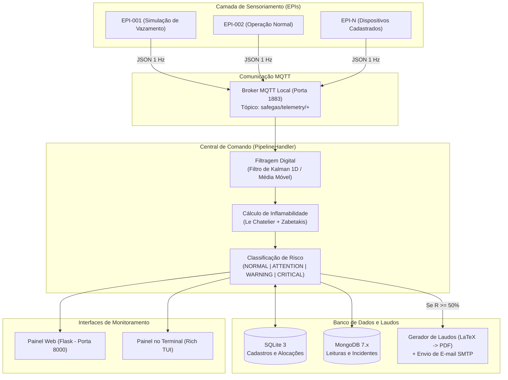

# SafeGas Monitor

## Integrantes
- **Gabriel Lourenço Ferreira Tavares** - Modelagem Matemática (Filtro de Kalman, Le Chatelier e Zabetakis), Banco de Dados (SQLite/MongoDB) e Geração de Laudos PDF em LaTeX (`gabriellftavares@gmail.com`)
- **Pedro Correia Scherer** - Comunicação MQTT, Simulador Multi-EPI, API REST e Painel Web em Flask (`Scherer.csch@gmail.com`)

## Descrição
O **SafeGas Monitor** é um sistema de monitoramento em tempo real para detecção de gases inflamáveis e tóxicos (LEL/LIE) em ambientes industriais confinados (NR-33). O projeto recebe leituras contínuas (1 Hz) de múltiplos Equipamentos de Proteção Individual (EPIs) detectores multigás (`CH4`, `CO`, `H2S`, `C3H8`, `C4H10` e temperatura) via protocolo **MQTT**, reduz ruídos de leitura utilizando **Filtro de Kalman Unidimensional (1D)**, calcula o risco composto da mistura gasosa pela **Lei de Le Chatelier** com correção térmica de **Zabetakis**, armazena os cadastros em **SQLite** e o histórico de leituras em **MongoDB**. Quando o risco atinge o nível crítico ($R \ge 50\%$), o sistema gera automaticamente um laudo técnico em **PDF via LaTeX** com gráficos do incidente e envia o arquivo por e-mail via **SMTP**.

## Tecnologias
- **Frontend**: HTML5, CSS3 (Painel de Supervisão Industrial com tema claro/escuro), JavaScript (Fetch API) e interface de terminal (`Rich TUI`)
- **Backend**: Python 3.11+, Flask 3.x (API REST), NumPy (Filtro de Kalman 1D e simulação de sinais), Paho-MQTT e aMQTT (Broker e clientes MQTT na porta `1883`)
- **Banco de dados**: SQLite 3 (cadastros de EPIs, funcionários, locais de risco, alocações e configurações) e MongoDB 7.x / PyMongo (histórico de telemetria e incidentes com modo de contingência caso o serviço esteja offline)
- **Relatórios e alertas**: Matplotlib (gráficos temporais), LaTeX / `pdflatex` (compilação dos laudos em PDF) e `smtplib` (envio de e-mails com anexo)

## Como executar
1. Instale as dependências Python na raiz do projeto:
   ```bash
   pip install -r requirements.txt
   ```
2. Configure o arquivo `.env` e as credenciais de e-mail (copiando dos arquivos de exemplo):
   ```bash
   cp .env.example .env
   cp config/secrets.py.example config/secrets.py
   ```
3. Caso queira recriar o banco SQLite manualmente (o sistema também cria e inicializa o banco automaticamente na primeira execução):
   ```bash
   sqlite3 database/sql/safegas.db < database/sql/schema.sql
   sqlite3 database/sql/safegas.db < database/sql/seed.sql
   ```
4. Execute o sistema integrado (Broker MQTT + Simulador Multi-EPI + Central + Servidor Flask + Terminal):
   ```bash
   python run_central.py
   ```
   *(No Windows, também é possível iniciar dando duplo clique em `start_safegas.bat`).*  
   Em seguida, abra o painel web no navegador em: **http://localhost:8000**

## Banco de dados
Os scripts SQL de estrutura (`schema.sql`) e carga inicial (`seed.sql`) estão em `database/sql/`, e o Diagrama Entidade-Relacionamento encontra-se em `docs/diagrama-er.png`.

## Referências
- ASSOCIAÇÃO BRASILEIRA DE NORMAS TÉCNICAS. **ABNT NBR IEC 60079-29-1**: Atmosferas explosivas - Parte 29-1: Detectores de gás - Requisitos de desempenho de detectores para gases inflamáveis. Rio de Janeiro: ABNT, 2016.
- BRASIL. Ministério do Trabalho e Previdência. **Norma Regulamentadora nº 33 (NR-33)**: Segurança e Saúde nos Trabalhos em Espaços Confinados. Brasília, DF: MTP, 2022.
- KALMAN, R. E. A new approach to linear filtering and prediction problems. **Journal of Basic Engineering**, v. 82, n. 1, p. 35-45, 1960.
- LE CHATELIER, H. Estimation of firedamp by flammability limits. **Annales des Mines**, v. 19, n. 8, p. 388-395, 1891.
- NATIONAL FIRE PROTECTION ASSOCIATION. **NFPA 325**: Guide to Fire Hazard Properties of Flammable Liquids, Gases, and Volatile Solids. Quincy, MA: NFPA, 2019.
- ZABETAKIS, M. G. **Flammability characteristics of combustible gases and vapors**. Washington, DC: U.S. Bureau of Mines, 1965. (Bulletin 627).

---

## Arquitetura e Fluxo de Dados



## Gases Monitorados e Níveis de Alerta

| Identificador | Gás | LEL (% v/v) | UEL (% v/v) | Característica Principal |
|---|---|---|---|---|
| `CH4` | Metano | 5,0% | 15,0% | Principal componente do gás natural; inflamável |
| `CO` | Monóxido de Carbono | 12,5% | 74,0% | Gás tóxico inodoro e inflamável em altas concentrações |
| `H2S` | Gás Sulfídrico | 4,0% | 44,0% | Alta toxicidade e inflamável em áreas confinadas |
| `C3H8` | Propano (GLP) | 2,1% | 9,5% | Mais denso que o ar; acumula próximo ao piso |
| `C4H10` | Butano (GLP) | 1,8% | 8,4% | Baixo limite inferior de explosividade |

| Nível de Alerta | Faixa de Risco ($R$) | Ação do Sistema |
|---|---|---|
| `NORMAL` | $R < 10\%$ | Operação segura; registro normal das leituras |
| `ATTENTION` | $10\% \le R < 25\%$ | Registro no histórico de eventos da Central |
| `WARNING` | $25\% \le R < 50\%$ | Alerta visual laranja no painel e no terminal |
| `CRITICAL` | $R \ge 50\%$ | Alarme crítico, geração do laudo PDF em LaTeX e envio por e-mail |

## Testes Automatizados

```bash
python tests/test_etapa1.py   # Contratos de dados e estrutura
python tests/test_etapa2.py   # Simulador de sensores e perfis de sinal
python tests/test_etapa3.py   # Comunicação MQTT e gerenciador de simulação
python tests/test_etapa4.py   # Filtros digitais (Média Móvel e Kalman 1D)
python tests/test_etapa5.py   # Cálculo LEL (Le Chatelier + Zabetakis) e Alertas
python tests/test_etapa6.py   # Persistência em SQLite e MongoDB
python tests/test_etapa7.py   # Gráficos Matplotlib e laudos LaTeX/PDF
python tests/test_etapa8.py   # Estado compartilhado e interface de terminal
python tests/test_etapa9.py   # Rotas da API Flask e abertura de laudos em PDF
```
